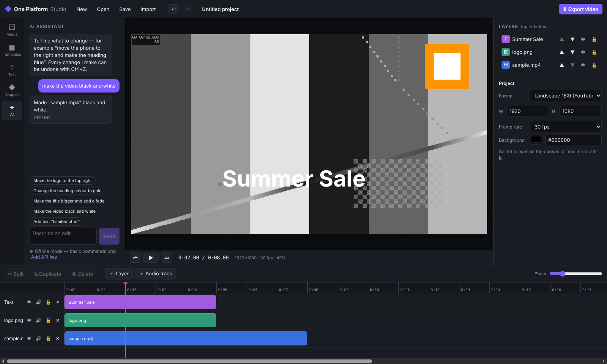

# One Platform Studio

A layer-based desktop video editor for Windows (also runs on macOS and Linux), with templates and an AI editing assistant. It aims to be easy for everyone: drag things around on the canvas, pick a template, or just type what you want changed.



> Status: **v0.1, working MVP.** You can import, edit, save, reopen and export real MP4s. AI object removal inside footage is on the roadmap and not built yet; see the bottom of this file.

## What it does today

| Area | Features |
|---|---|
| **Canvas** | Click to select any layer · drag to move · corner/edge handles to resize (media keeps its aspect ratio, Shift to free-resize) · rotate handle (Shift snaps to 15°) · snapping guides to the centre and edges · arrow-key nudging |
| **Layers** | Every element is its own layer · show/hide · lock · reorder (drag or ▲▼) · rename |
| **Timeline** | Multiple video/image/text/shape layers and audio tracks · drag clips in time and between tracks · trim both ends · split at playhead (S) · duplicate · snapping to the playhead and clip edges · zoom |
| **Elements** | Video, images/logos, audio, text (font, size, bold/italic, alignment, colour, highlight box), shapes (rectangle, rounded, circle, frame, line, lower bar) |
| **AI object tools** | Click an object in a video (person, product, phone, car…) and the AI outlines it and follows it through the clip. Then **Remove** it (background rebuilt from other frames), **Move** it (cut out onto its own draggable layer and fill the hole), **Cut out** a copy, or **Blur/Pixelate** it so the effect follows it. Runs free and offline on an ordinary laptop's CPU (MobileSAM) |
| **Fix areas** | Draw a box on a video or image to **remove** a logo or watermark (filled in from the surrounding pixels), **blur** a face or number plate, or **pixelate** it. Boxes stick to the clip when it moves, can apply to the whole clip or a time range, and show live in the preview |
| **Motion & colour** | In/out animations (fade, slide up/down/left/right) · brightness/contrast/saturation · opacity · volume |
| **Templates** | Product Launch, Mobile App Promo, Instagram Reel (9:16), YouTube Intro, Property Showcase. All of them are editable layers, and their ＋ slots take your own media via *Replace media* |
| **AI assistant** | Type edits like *"move the logo to the top right"*, *"make the heading gold"* or *"make the video black and white"*. With a Claude API key it understands free-form requests; without one, an offline parser handles common commands. Every AI edit can be undone |
| **Projects** | Save/open `.oneproj` files · autosave every 30 s with crash recovery · undo/redo for everything |
| **Export** | MP4 (H.264 + AAC) through FFmpeg, in draft, standard or high quality · progress bar and cancel · output matches the preview |

## Run it

Requires Node.js 20+.

```bash
npm install
npm start            # build and launch the desktop app
```

Development with hot reload:

```bash
npm run dev          # Vite dev server + Electron
npm run dev:web      # UI only, in a browser (export disabled)
```

Build a Windows installer (run this on Windows):

```bash
npm run dist:win     # → release/One Platform Studio Setup x.y.z.exe
```

FFmpeg and FFprobe are bundled through `ffmpeg-static` / `ffprobe-static`, so users don't need to install anything. Set `ONE_FFMPEG` / `ONE_FFPROBE` to use a different build.

### AI assistant

Open the **AI** tab and choose **Add API key**. The key is stored encrypted with the OS keychain via Electron `safeStorage`. Alternatively set `ANTHROPIC_API_KEY` before launching. The app uses `claude-opus-5-5` by default.

## Tests

```bash
npm test             # engine unit tests + real FFmpeg export tests (pixel-checked)
npm run typecheck
npm run build && xvfb-run -a node scripts/e2e.mjs out/   # full desktop E2E (Linux); drop xvfb-run elsewhere
```

The E2E script launches the real Electron app. It imports media, edits on the canvas and timeline, uses the AI assistant, splits, saves, reopens and exports, and writes screenshots to `out/`.

### How the AI object tools work

1. Frames of the selected clip section (up to 30 s) are decoded at ≤640 px, 10–15 fps.
2. **MobileSAM** (`models/`, ONNX, run with `onnxruntime-node` on the CPU) turns your clicks into an outline.
3. **Tracking** (`src/main/vision/track.ts`) prompts each next frame with the predicted box and an interior point. Outlines are clipped to where the object can plausibly be, and a size check with short "coasting" stops leaks into similar-looking background.
4. **Fill** (`fill.ts`): each hidden pixel takes its value from the nearest frame where it's visible. Pixels that are never visible use a push-pull pyramid fill.
5. FFmpeg composites the result at full resolution and frame rate into a **new video file** (originals are never changed; Ctrl+Z restores the old clip). Cut-outs are VP9 WebM with transparency.

About 0.5 s per analysed frame on a 4-core CPU, so a 4 s clip takes roughly 30–40 s to track.

## Architecture

```
src/
  engine/        Pure TypeScript, no UI or Node APIs: the heart of the editor
    types.ts       Project → Tracks (layers) → Clips, MediaAssets
    commands.ts    Every edit is an EditCommand → applyCommand() returns a new Project
    history.ts     Undo/redo (snapshots; projects are immutable)
    export.ts      Project → FFmpeg filter graph / command line
    templates.ts   Templates are just projects built from commands
    ai.ts          AI action schema, prompt, validation, offline parser
  main/vision/   AI object tools: MobileSAM (ONNX), tracking, background fill, rendering
  main/          Electron main process: file dialogs, media:// protocol (range
                 requests for seeking), ffprobe import, FFmpeg export job, Claude API
  renderer/      React UI: canvas preview, timeline, layers, properties, AI chat
    render.ts      Canvas drawing shared by preview AND export rasterisation
  shared/api.ts  Typed bridge between main and renderer (window.api)
```

Key design decisions:

- **One command pipeline.** Mouse drags, keyboard shortcuts, templates and the AI all produce the same `EditCommand`s. That is why the AI can't do anything a user couldn't, and why everything is undoable.
- **Preview equals export.** Text and shapes are drawn by the same canvas code for the preview and for export (rasterised to PNG). Animation maths lives in one function (`animationAt`) and the exporter generates matching FFmpeg expressions. The tests check exported pixels.
- **Local-first.** Editing and rendering happen on the user's PC. The only network call is the optional Claude request.

## Roadmap

0. ✅ **Fix areas** (remove / blur / pixelate a rectangle over a time range), done.
1. ✅ **AI object selection and tracking**, done (MobileSAM, Apache-2.0, on the CPU).
2. ✅ **Object removal / move / cut-out / blur**, done. The background is rebuilt from other frames (works best with a still camera), with smooth fill for areas that are never uncovered.
2b. Next: handle camera motion (align frames before filling), an optional AI inpainting model for large never-uncovered areas, and a faster "preview quality" mode.
3. Background removal for people, auto-captions (speech-to-text), keyframe animation, transitions between clips, more templates, a GPU preview pipeline (WebCodecs / native decoder) for 4K timelines.

## Licensing note

The bundled `ffmpeg-static` binaries are GPL builds. Before selling the app commercially, either comply with the GPL or ship an LGPL FFmpeg build (set `ONE_FFMPEG`).
